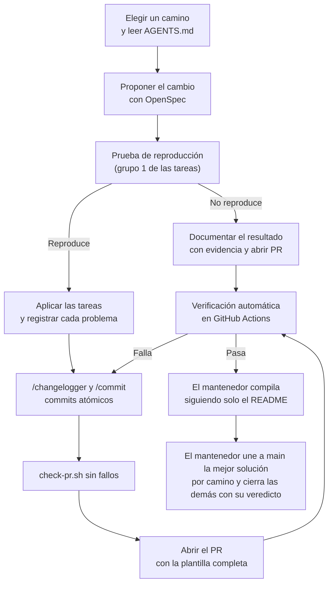

# Reto de contribución

*Última modificación: 18 de octubre de 2026, 19:46 (CST)*

Este documento describe un reto abierto para quien quiera demostrar cómo trabaja con inteligencia artificial en un proyecto real: construir una de las versiones pendientes de DAZNer con **desarrollo guiado por especificaciones** (*spec-driven development*, SDD) y no con *vibe coding*. Sirve para cualquier persona y cualquier herramienta de IA. El mantenedor usa este mismo documento para probar el flujo de *pull requests* del proyecto.

## Qué se busca demostrar

Que el resultado sale de un proceso controlado y no de la suerte:

- **Las especificaciones mandan.** El código nace de lo que describen las especificaciones y las tareas de OpenSpec, no de indicaciones sueltas a un asistente.
- **Honestidad técnica.** Informas lo que ejecutaste y lo que no, y documentas los fallos en lugar de esconderlos.
- **Reproducibilidad.** Otra persona puede clonar el repositorio, seguir la documentación y obtener un programa que funciona **sin tener que investigar nada por su cuenta**.

## Reglas

1. **SDD, no *vibe coding*.** En cada cambio sigue este orden: lee la especificación, propón el cambio (`proposal`, `design` y `tasks`), pide su revisión y solo después aplícalo. `openspec validate --all --strict` debe pasar.
2. **Cualquier herramienta de IA.** Claude, Codex, Gemini, Copilot, la que prefieras. Instala OpenSpec para la tuya (`openspec init --tools <herramienta>`; consulta su documentación para ver cuáles admite) y declara cuál usaste en cada PR.
3. **Usa las reglas del proyecto.** Haz un *fork* de [incognia/rules](https://github.com/incognia/rules) y aplica sus procedimientos de `/changelogger` y `/commit`, con sus CoT y *rulesets*. Si tu herramienta no carga *skills*, los CoT son Markdown y puedes pasárselos como instrucciones. Úsalos con tu propio entorno e identidad: el mantenedor revisa el resultado, no la herramienta.
4. **Todo entra por *pull request*,** nunca por *push* directo a `main`, y con la plantilla de [.github/PULL_REQUEST_TEMPLATE.md](.github/PULL_REQUEST_TEMPLATE.md) completa.
5. **Prohibido:** eludir el DRM, los controles de acceso o los límites de reproducción de DAZN; redistribuir módulos de DRM; guardar credenciales en archivos, registros o *commits*; marcar una tarea como hecha sin haberla ejecutado.
6. **Una cuenta de GitHub por persona.** Participa con una sola cuenta, que es solo tuya, y no uses otra para el mismo reto. El mantenedor no puede comprobar que una cuenta sea una sola persona, así que lo pide como declaración: en la sección «Decisiones» del PR escribe que la cuenta es solo tuya y que no participas con otra. Faltar a esa declaración cuenta como falta de honestidad. Si trabajas en equipo sobre una misma solución, declara en el PR quiénes participaron; el mantenedor lo evalúa como una sola entrega.

Lee antes [AGENTS.md](AGENTS.md): resume la estructura, las decisiones ya tomadas y lo descubierto sobre DAZN.

## Flujo



## Ramas y *pull requests*

- **Un *fork* por persona** y una rama por cambio, con el nombre `challenge/<usuario>/<cambio>`, por ejemplo `challenge/ana/add-windows-port`. El nombre de usuario queda en la rama y abres el PR desde ella hacia `main` de este repositorio. No crees carpetas por persona: la estructura del repositorio no cambia.
- **Entra a `main` una sola solución por camino:** la mejor según los criterios de evaluación. El mantenedor no une los demás PR: los cierra con su veredicto por escrito y el trabajo se queda en el *fork* de cada persona.
- **Responder a una revisión.** Como el mantenedor no acepta `fixup!` y `CHANGELOG.md` debe cambiar solo en el último *commit*, para corregir un PR tienes que reescribir **tu propia rama** (`rebase` o `amend`) y subirla con `git push --force-with-lease`. Es válido en tu rama de PR. Nunca fuerces el *push* a `main` ni a la rama de otra persona.

## Ejemplos de *commits*

Cada *commit* sigue el formato de `/commit`: asunto en inglés (UK) con Conventional Commits, cuerpo en viñetas desde la columna 1 y, al final, el `Co-Authored-By` de **tu** herramienta, modelo y esfuerzo. Estos tres ejemplos forman una serie atómica de un mismo PR, escrita con herramientas distintas. Los cambios, los modelos y los niveles de esfuerzo son ilustrativos.

Primer *commit*, hecho con Claude, modelo Opus y esfuerzo medio:

```text
feat(windows): add borderless window with a drag strip

- Add a borderless WPF window with a 14 px strip at the top edge that
  moves the window when dragged
- Keep Alt + drag as a second way to move it from any point

Co-Authored-By: Claude Opus 5.5 (medium) <noreply@anthropic.com>
```

Segundo *commit*, hecho con Codex, modelo Luna y esfuerzo bajo:

```text
fix(windows): keep the aspect ratio while resizing

- Handle WM_SIZING so that dragging any edge or corner keeps the
  window at 16:9, or at 32:9 with two panes
- Stop the window from growing past the work area of the monitor

Co-Authored-By: Codex GPT-6 Luna (low) <noreply@openai.com>
```

Tercer *commit*, hecho con Gemini, modelo Flash y esfuerzo alto. Es el último de la serie, así que además lleva el `CHANGELOG.md`, sin mencionarlo en el cuerpo:

```text
docs(windows): document the WebView2 runtime requirement

- Add the WebView2 runtime and the .NET version to the requirements of
  the Windows build section
- Record the encoding problem found when building from Windows
  PowerShell 5.1 and how it was solved

Co-Authored-By: Antigravity Gemini 3.8 Flash (high) <noreply@antigravity.google>
```

Qué observar en los tres:

- **El asunto** es `tipo(ámbito): resumen`, en inglés (UK) y sin punto final.
- **Las viñetas** empiezan en la columna 1, y una línea larga continúa con dos espacios de sangría.
- **El `Co-Authored-By`** cambia en cada *commit* porque cada uno declara su herramienta, su modelo y su esfuerzo, y el correo depende de la herramienta. Un mismo PR puede mezclar herramientas.
- **No copies estos valores.** Genera el tuyo con `python3 ~/rules/scripts/commit_trailer.py`, que lee la sesión activa en Claude Code, Codex, Copilot CLI y Antigravity CLI. Si tu herramienta no lo admite, usa lo que reporte tu propia sesión con el mismo formato.

## Caminos

Puedes hacer uno o varios. Cada uno es un cambio de OpenSpec que ya está propuesto en `openspec/changes/`.

| Camino | Cambio | Dónde compilas y pruebas | Dificultad |
|---|---|---|---|
| Windows | `add-windows-port` | Windows (compilación nativa; *commits* desde WSL si prefieres) | Media |
| Linux con Qt | `add-linux-qt-port` | Linux; distribución recomendada: Fedora | Alta |
| Linux con GTK (experimental) | `add-linux-gtk-port` | Linux; distribución recomendada: Fedora | Alta, y puede no ser viable |

Notas de cada camino:

- **Script compartido.** El *script* de pantalla completa (`shared/fill-fullscreen.js`) ya está en el repositorio, listo para que cada versión lo cargue. El mantenedor no lo evalúa y no necesitas una Mac.
- **Windows.** El `design.md` del cambio tiene que responder dónde vive el clon que compilas, cómo evitas el ruido de codificación (el repositorio es UTF-8 y Windows usa Windows-1252 en muchos programas), cómo ejecutas `/commit` y `/changelogger` si haces el control de versiones desde WSL, y qué verificaste en Windows y qué no.
- **Linux.** Fedora no incluye en sus paquetes los códecs H.264 ni AAC, por patentes; los obtienes del repositorio de terceros RPM Fusion. Comprueba si el motor web que uses los necesita y documenta cómo los obtuviste. No redistribuyas el módulo de DRM Widevine: tómalo de una instalación de Chrome. En Wayland una aplicación no puede fijar la posición de la ventana ni imponer una proporción; documéntalo como limitación. WebKitGTK probablemente no reproduzca DAZN: si la prueba falla, **un PR que documente con evidencia por qué no funciona cuenta igual de bien**.

En todos los casos, el primer grupo de tareas es la **prueba de reproducción**: comprobar que DAZN reproduce dentro del motor web de esa plataforma. Si falla, detén el trabajo y documenta el resultado.

## Bitácora de problemas y dependencias

Durante las iteraciones aparecerán errores, dependencias y pasos que no estaban previstos. **Ninguno debe quedarse solo en tu máquina o en tu cabeza.** Documentarlos permite que otra persona tome precauciones antes de compilar.

Registra cada problema o dependencia en el momento en que aparece, en dos lugares:

1. **`design.md` del cambio**, en `Risks / Trade-offs` si es un riesgo y en `Open Questions` si queda sin resolver.
2. **La sección de requisitos de `README.md`** de esa plataforma, si es un requisito para compilar o ejecutar (herramientas, versiones, repositorios de terceros, permisos).

Usa este formato, una entrada por problema:

| Síntoma | Causa | Solución | ¿Requiere acción previa de quien compila? |
|---|---|---|---|
| Lo que observaste, con el mensaje de error exacto | Por qué ocurre | Qué hiciste para resolverlo | Sí o no, y cuál |

En el PR, resume esa bitácora en las secciones «Qué no se probó», «Decisiones» y «Riesgos» de la plantilla. Un problema que resolviste pero no documentaste cuenta como un problema que sigue abierto.

## Evidencia

Las capturas de pantalla de un video con DRM salen en negro y no sirven. La evidencia de que algo funciona son **fotos de cómo se ve la pantalla**, tomadas con un celular:

| Aceptado | Condiciones |
|---|---|
| **Fotos tomadas con un celular** | En formato **horizontal**, porque las pantallas son 16:9 o 32:9. Muestra la ventana completa de la aplicación y el contenido reproduciéndose. |

| No aceptado | Motivo |
|---|---|
| Capturas de pantalla negras | No prueban nada. |
| Capturas hechas con capturadoras de video | Eluden la protección del contenido, y este proyecto no la elude. |
| Videos o grabaciones de pantalla | La evidencia son solo fotos. |

Recomendaciones para que la evidencia sirva:

- Muestra algo que identifique la plataforma (la barra de tareas, la barra de menús o el escritorio) y la ventana de DAZNer completa.
- Evita que aparezcan correos, nombres de usuario, datos de la suscripción o cualquier dato personal.
- Anota cada foto en la tabla «Cómo se verificó» del PR, con la tarea que respalda.
- Un PR es público: si prefieres no publicar una foto en la que aparece una transmisión, envíala por un canal privado al mantenedor y anota en el PR que existe.

## Cómo se evalúa

### 1. Puertas automáticas

El mantenedor rechaza sin revisar el código un PR que no pase [`check-pr.sh`](https://github.com/incognia/rules/blob/main/scripts/check-pr.sh). Las puertas están descritas en [PR_CHECK.md](https://github.com/incognia/rules/blob/main/rulesets/PR_CHECK.md): *commits* atómicos en inglés (UK) con Conventional Commits y `Co-Authored-By` de la herramienta usada, `CHANGELOG.md` solo con viñetas añadidas y en el último *commit*, ningún archivo ajeno (binarios, registros, reformateos), la plantilla del PR completa y OpenSpec en verde. Córrelo antes de abrir el PR:

```bash
~/rules/scripts/check-pr.sh --base origin/main
```

### 2. Compilar sin intervención

Es la prueba principal. Quien mantiene el proyecto clona tu rama en una de sus máquinas, **sigue únicamente lo que dice el README** y ejecuta el comando de compilación:

- **Si compila y arranca sin investigar nada por su cuenta** (sin buscar un error, instalar algo no documentado ni modificar un archivo), el resultado cuenta como aprobado. Todo lo que tuvo que resolver en el camino tenía que estar en la bitácora.
- **Si tiene que investigar,** anota qué faltaba en la documentación y te devuelve el PR con esa lista. Puedes corregirlo y volver a intentarlo.
- **El mantenedor prueba la compilación en una plataforma distinta de la tuya** cuando es posible, para descartar que funcione solo en tu entorno.

### 3. Criterios, en orden de importancia

| Criterio | Peso |
|---|---|
| Disciplina SDD: las especificaciones y las tareas preceden al código, y las tareas reflejan lo ejecutado | 30 % |
| Compila y arranca en otra máquina sin intervención, con la bitácora completa | 25 % |
| Calidad de los PR y de los *commits* | 20 % |
| Honestidad: no afirma lo que no ejecutó, reporta los fallos y cumple la declaración de una cuenta por persona | 15 % |
| Calidad técnica del resultado | 10 % |

## Resultado

Si tu PR compila y arranca sin intervención, y cumple las demás reglas, **el mantenedor hace un *referral* de forma automática**: demostrar este nivel de madurez en el uso de IA es justo lo que busca el reto. Un *referral* es una recomendación y no una promesa: la decisión de contratar depende de los procesos y de las personas de la empresa, no del mantenedor. Un PR que documenta con evidencia por qué algo no es viable también cuenta como un buen resultado.

## Suscripción y seguridad

- El mantenedor corre la prueba real de reproducción contra DAZN con tu rama, en su propia cuenta y en su propio equipo. **No compartas cuentas ni credenciales:** los datos de acceso de una cuenta de DAZN son personales.
- Si tienes tu propia suscripción con NFL Game Pass, puedes hacer la prueba de reproducción en tu equipo con tu cuenta. Si no, valida el motor web con una página de demostración de DRM y deja claro en el PR que la prueba contra DAZN queda pendiente.
- Nunca escribas credenciales ni datos personales en archivos, registros, fotos ni *commits*. Las reglas de la evidencia están en la sección anterior.

## Qué no cuenta

- Código sin la especificación o la tarea que lo respalda.
- Tareas marcadas como hechas que no ejecutaste.
- Problemas que resolviste pero no documentaste.
- Cambios ajenos al alcance del cambio de OpenSpec que elegiste, o archivos generados (binarios, registros, firmas).
- Modificar las comprobaciones o la plantilla del PR para que un PR pase. El mantenedor revisa esos cambios a mano.

## Glosario

- **Bitácora.** Registro de cada problema o dependencia que aparece durante el trabajo, con su síntoma, su causa, su solución y si exige una acción previa a quien compila.
- **Camino.** Cada una de las versiones que puedes construir: Windows, Linux con Qt o Linux con GTK. Cada camino corresponde a un cambio de OpenSpec.
- **CHANGELOG.** Archivo `CHANGELOG.md` con el historial de cambios del proyecto: una viñeta por cambio, agrupadas por fecha. En este reto solo añades viñetas, y solo en el último *commit* de tu PR.
- **Co-Authored-By.** Línea al final de un *commit* que nombra la herramienta de IA y el modelo que ayudaron a escribirlo, con el formato `Co-Authored-By: [Herramienta ]Modelo (esfuerzo) <correo>`. Cada *commit* lleva la de la herramienta que realmente usaste.
- **Códec.** Formato con el que se comprimen el audio y el video, como H.264 (video) y AAC (audio).
- ***Commit* atómico.** *Commit* que contiene un solo cambio lógico, de modo que puedes entenderlo y revertirlo por separado.
- **Conventional Commits.** Convención para escribir el asunto de un *commit* como `tipo(ámbito): resumen`, con tipos como `feat`, `fix` y `docs`.
- **CoT (*Chain of Thought*).** Procedimiento paso a paso, escrito en Markdown, que le das a una IA como instrucciones. Los del proyecto están en el repositorio `rules`, en la carpeta `cot/`.
- **DRM.** Protección que impide copiar o capturar contenido protegido. Por eso una captura de pantalla de un video sale negra. Cada sistema usa la suya: FairPlay en Apple y Widevine en Chrome y los motores basados en Chromium.
- **Especificación.** Descripción verificable de lo que el sistema debe hacer, con requisitos y escenarios. Las del proyecto viven en `openspec/specs/`.
- ***Fixup*.** *Commit* de corrección (`fixup!`) pensado para fusionarse con uno anterior. Este reto no lo acepta en un PR: reescribe tu rama en su lugar.
- ***Force push* y `--force-with-lease`.** Subir una rama reescribiendo su historial. `--force-with-lease` lo hace solo si nadie más actualizó la rama desde la última vez que la leíste. Úsalo únicamente en tu propia rama de PR.
- ***Fork*.** Copia personal de un repositorio en tu propia cuenta, desde donde trabajas y abres tus *pull requests*.
- **GitHub Actions.** Servicio de GitHub que ejecuta verificaciones automáticas en cada PR. Aquí corre `check-pr.sh`.
- **Mantenedor.** Persona que mantiene el proyecto, revisa los PR y decide qué une a `main`.
- **Motor web.** Componente que muestra páginas web dentro de una aplicación. En este proyecto: WebKit en macOS, WebView2 en Windows, Qt WebEngine y WebKitGTK en Linux.
- **OpenSpec.** Marco ligero para el desarrollo guiado por especificaciones. Guarda en `openspec/specs/` lo que el sistema hace hoy y en `openspec/changes/` cada cambio propuesto, con su propuesta, sus especificaciones, su diseño y sus tareas.
- **Paridad.** Que una versión nueva se comporte como la de macOS, según las especificaciones de `openspec/specs/`, salvo las excepciones documentadas.
- **Prueba de reproducción.** Primera tarea de cada camino: comprobar que DAZN reproduce dentro del motor web de esa plataforma. Si falla, detienes el trabajo y documentas el resultado.
- **Puertas.** Condiciones que un PR debe cumplir para no ser rechazado, como el formato de los *commits*, las reglas del CHANGELOG o la plantilla completa. `check-pr.sh` verifica la mayoría.
- ***Pull request* (PR).** Solicitud para unir los cambios de una rama con otra. En este reto, de tu rama a `main`.
- ***Rebase* y *amend*.** Dos formas de reescribir los *commits* de tu propia rama: *rebase* los vuelve a aplicar en otro orden o sobre otra base, y *amend* corrige el último. Sirven para responder a una revisión sin añadir *commits* de corrección.
- ***Referral*.** Recomendación que una persona hace de otra ante una empresa para un proceso de selección. No garantiza la contratación.
- **RPM Fusion.** Repositorio de terceros para Fedora que ofrece paquetes que Fedora no incluye por patentes o licencias, como los códecs H.264 y AAC.
- ***Ruleset*.** Documento con las reglas de un tema, como `COMMITTING.md`, que vive en el repositorio `rules`.
- **SDD (*spec-driven development*, desarrollo guiado por especificaciones).** Forma de trabajar en la que primero escribes y revisas **qué debe hacer** el sistema, y el código y las tareas se derivan de esa especificación. La especificación es la fuente de verdad y permite comprobar si el resultado es correcto.
- ***Skill*.** Instrucción reutilizable que una herramienta de IA puede ejecutar con un comando, como `/commit`, `/changelogger` o `/pr-check`.
- ***Vibe coding*.** Programar pidiéndole resultados a una IA en lenguaje natural y aceptar el código sin especificarlo, revisarlo ni verificarlo. Sirve para un prototipo rápido, pero no te deja saber qué construiste ni por qué funciona, y por eso este reto no lo acepta.
- **Wayland.** Servidor gráfico moderno de Linux, sucesor de X11. Maneja distinto que X11 la posición y el tamaño de las ventanas, por eso las limitaciones se documentan por servidor gráfico.
- **Widevine.** Sistema de DRM de Google que usan Chrome y los motores basados en Chromium. No lo redistribuyas: tómalo de una instalación de Chrome.
- **WSL.** Subsistema de Windows para Linux: un entorno Linux que corre dentro de Windows. En este reto puedes usarlo para ejecutar `git` mientras compilas en Windows nativo.
